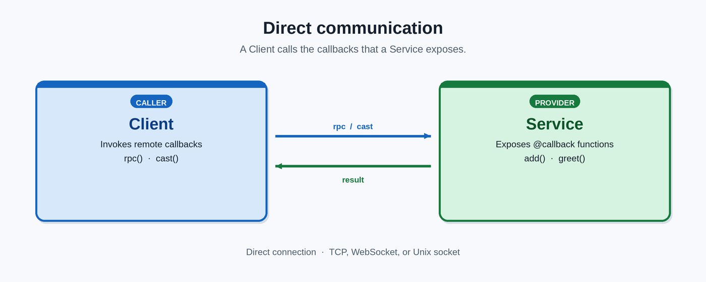
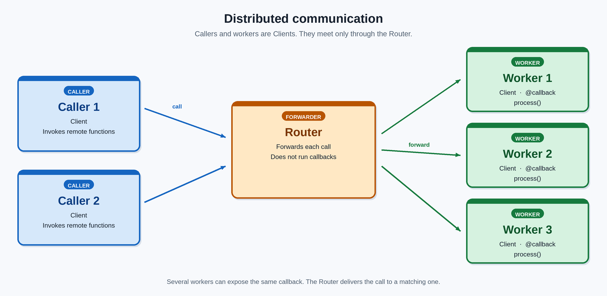

# Daffi

### High-performance RPC for Python.

[](#)
[](#)
[](https://www.python.org/)
[](https://opensource.org/licenses/MIT)

A lightweight inter-process communication framework powered by a compiled native core.
Connect Python applications, distribute workloads, and exchange data with minimal overhead.

**📖 Full documentation: [https://600apples.github.io/daffi/](https://600apples.github.io/daffi/)**

---

## Why Daffi?

- **No external broker required** — Establish direct connections without additional infrastructure.
- **Simple remote calls** — Invoke remote functions through familiar Python interfaces.
- **Multiple communication patterns** — Support RPC, broadcast, and streaming.
- **Native runtime** — Choose between threaded and event-driven connection handling.
- **Efficient data transfer** — Exchange large binary payloads with minimal overhead.

---

## Architecture

Daffi supports two primary communication topologies: direct communication between a Client and a Service,
and distributed communication through a Router.

#### Core components

| Component | Description                                                                               |
|-----------|-------------------------------------------------------------------------------------------|
| `Service` | Listens for incoming connections and exposes remotely callable _@callback_ functions.     |
| `Router`  | orwards messages between connected nodes. It does not execute callbacks itself.           |
| `Client`  | Connects to a Service or Router. It can issue remote calls, expose callbacks, or do both. |

#### Direct communication

In a direct connection, a Client communicates with a Service.



- The Service exposes callbacks.
- The Client invokes those callbacks remotely.

#### Distributed communication

A Router enables multiple Clients to participate in a shared communication network.



- Workers expose callbacks through their Client connections.
- Callers invoke remote functions through the Router.
- The Router forwards calls to matching workers.
- Multiple workers can provide the same callback.


---

## Installation

```bash
pip install daffi
```

Requires Python 3.10 or newer.

## Quick start — direct communication

1. Create a `Service` instance.

`service.py`:
```python
from daffi import Service, callback, TCPTransport

@callback
def add(a: float, b: float) -> float:
    return a + b

@callback
def greet(name: str) -> str:
    return f"Hello, {name}!"

svc = Service(app_name="my-service", transport=TCPTransport("127.0.0.1", 5000))
svc.start()
svc.join()          # block until svc.stop() is called
```

2. Connect a `Client` to the Service.

`client.py`:
```python
from daffi import Client, TCPTransport

client = Client(app_name="my-client", transport=TCPTransport("127.0.0.1", 5000))
conn = client.connect()

result = conn.rpc().add(1, 2)     # → 3.0
greeting = conn.rpc().greet("Alice")  # → "Hello, Alice!"

client.stop()
```

3. Run the example.

Start the Service first:

```bash
python service.py
```
Then, in another terminal:

```bash
python client.py
```

##  Distributed architecture — Router and Workers

1. Start a `Router` instance.

`router.py`:
```python
from daffi import Router, TCPTransport

router = Router(transport=TCPTransport("127.0.0.1", 6000))
router.start()
router.join()
```

2. Register a `Worker`

`worker.py`:
```python
from daffi import Client, callback, TCPTransport

@callback
def process(task: str) -> str:
    return f"done: {task}"

client = Client(app_name="worker-1", transport=TCPTransport("127.0.0.1", 6000))
client.connect()
client.join()   # block until Ctrl+C / SIGTERM
```

3. Create a `Client`.

`caller.py`:
```python
from daffi import Client, TCPTransport

client = Client(app_name="caller", transport=TCPTransport("127.0.0.1", 6000))
conn = client.connect()

# RPC — routed to one worker (round-robin if many workers expose the same function)
result = conn.rpc().process("job-42")

# Cast — sent to *all* workers, returns {worker_name: result} (in this case, only one worker)
all_results = conn.cast().process("broadcast-job")

client.stop()
```
---

## Communication patterns

Daffi provides several communication patterns through the connection handle returned by `client.connect()`.

```python
conn = client.connect()
```

Each method returns a proxy that allows remote functions to be invoked through attribute access.

### RPC — `rpc()`

Execute a remote function and wait for its result.

In a Router topology, calls are distributed across matching workers using round-robin selection.

```python
result = conn.rpc().echo("hello")

# Or 

result = conn.rpc(
    timeout=5,
    serde=SerdeFormat.JSON,
).add(1, 2)
```

To target a specific worker, use `receiver`:

```python
result = conn.rpc(
    timeout=5,
    receiver="worker-1",
).process("task")
```

`receiver` is only relevant when connecting through a Router with multiple workers.

### Fire-and-forget — `rpc_nowait()`

Invoke a remote function without waiting for its result.

```python
conn.rpc_nowait().notify("event happened")
```

### Broadcast — `cast()`

Execute a remote function on all matching workers and collect their results.

The returned dictionary maps worker names to their respective results.

```python
results = conn.cast(timeout=5).echo("ping")

# Example:
# {
#     "worker-01": "ping",
#     "worker-02": "ping",
# }
```

### Broadcast without waiting — `cast_nowait()`

Broadcast a function call without collecting results.

```python
conn.cast_nowait().notify("broadcast event")
```

### Streaming — `stream()`

Send data in chunks.

The sender waits for acknowledgement before sending the next chunk.

```python
@callback
def process_stream(data: bytes) -> None:
    ...


# Split a large payload into fixed-size chunks (e.g. 64 KiB)
payload = open("large.bin", "rb").read()
chunks = [payload[i:i + 65536] for i in range(0, len(payload), 65536)]

sender = conn.stream(serde=SerdeFormat.OPAQUE)

for chunk in chunks:
    sender.process_stream(chunk)
```

Or pass an iterator / generator directly — `stream()` consumes it and sends each yielded value:

```python
def chunk_source(path: str, size: int = 65536):
    with open(path, "rb") as f:
        while chunk := f.read(size):
            yield chunk


conn.stream(serde=SerdeFormat.OPAQUE).process_stream(
    chunk_source("large.bin"),
)
```

### Streaming without waiting — `stream_nowait()`

Send streaming data without waiting for acknowledgements.

```python
conn.stream_nowait(serde=SerdeFormat.OPAQUE).process_stream(
    chunk_source("large.bin"),
)
```

See the communication patterns guide for additional examples and configuration options.

---

## Serialization

Daffi supports multiple serialization formats, allowing applications to choose between 
interoperability, readability, flexibility, and performance.

Specify the desired format using `serde=SerdeFormat.X` on a communication method.

| Format    | Description                                            | Typical use case                |
|-----------|--------------------------------------------------------|---------------------------------|
| `MSGPACK` | Compact binary serialization. Default format.          | General-purpose communication   |
| `JSON`    | Human-readable, JSON-compatible data.                  | Interoperability and debugging  |
| `OPAQUE`  | Raw bytes or strings without structured serialization. | High-throughput data transfer   |
| `PICKLE`  | Python object serialization.                           | Python-specific object exchange |

### Examples

```python
from daffi import Client, SerdeFormat

conn = client.connect()

# MessagePack (default)
result = conn.rpc().add(1, 2)

# JSON
result = conn.rpc(
    serde=SerdeFormat.JSON,
).add(1, 2)

# Opaque binary data
result = conn.rpc(
    serde=SerdeFormat.OPAQUE,
).receive_data(binary_payload)
```

### Pickle serialization

Pickle supports Python-specific objects but requires special care.

Deserializing untrusted pickle data can execute arbitrary code. 
Only use it when the sender and transmitted data are trusted.

Daffi also provides a receiver-side deserialization policy:

```python
serde=SerdeFormat.PICKLE
```

The receiver can use:

```python
serdes=SerdeFormat.SAFE
```

to refuse pickle deserialization.


---

## Callbacks and concurrency

Callbacks are Python functions or bound methods that can be invoked remotely by other nodes.

### Defining callbacks

Use the `@callback` decorator to register a remotely callable function.

```python
from daffi import callback


@callback
def echo(payload):
    return payload


@callback
def compute(x: int, y: int) -> int:
    return x * y
```

Callback registration happens at import time.

Both `Service` and `Client` instances can expose callbacks.

### Concurrent callback execution

By default, each node executes incoming callbacks sequentially using a single execution thread:

```python
workers=1
```

To execute multiple callbacks concurrently, configure the `workers` parameter.

```python
import time

from daffi import Service, callback, TCPTransport


@callback
def slow_task(n: int) -> int:
    time.sleep(1)
    return n * n


svc = Service(
    workers=4,
    transport=TCPTransport("127.0.0.1", 5000),
)

svc.start()
svc.join()
```

With `workers=4`, up to four callbacks can execute concurrently.

The same parameter is available on a `Client` acting as a worker:

```python
client = Client(
    app_name="worker-1",
    workers=8,
    transport=TCPTransport("127.0.0.1", 6000),
)
```


## Native runtime

Daffi's compiled core supports two connection-handling models, configurable through the `runtime` argument.

### Runtime modes

| Runtime   | Description                                                              |
|-----------|--------------------------------------------------------------------------|
| `threads` | Creates an operating-system thread for each connection. Default runtime. |
| `evented` | Multiplexes connections across a small number of event-loop threads.     |

### Selecting a runtime

```python
from daffi import Runtime, Router, TCPTransport

router = Router(
    transport=TCPTransport("127.0.0.1", 6000),
    runtime=Runtime.EVENTED,
)
```

Omitting `runtime` selects the default `threads` implementation.

The runtime is selected per process. 
A process cannot mix the two runtime models; conflicting initialization raises `InitializationError`.

### Event-loop configuration

Use the `DAFFI_EVENT_LOOPS` environment variable to configure the number of event-loop threads.

The default is one loop per CPU, capped at 64.

```bash
DAFFI_EVENT_LOOPS=4 python router.py
```

> The runtime selection is independent of `daffi.aio`, which provides Daffi's Python asyncio API
and works with both native runtime models.

### Choosing a runtime

Use `threads` when:

- Connections may be slow to read large messages or streams.
- Your application primarily uses connections that benefit from independent thread handling.

Use `evented` when:

- A Router or Service needs to maintain many simultaneous connections.
- Native thread count is a limiting resource.
- Most connections are idle, such as workers waiting for tasks.

See the [runtime guide](https://600apples.github.io/daffi/usage/runtime/) for implementation details.

---

## Transports

Daffi supports multiple transport mechanisms for communication between processes.

`Client` accepts a single transport. 
`Router` and `Service` accept one transport or a sequence of them — every listener shares that node's membership, 
and `start()` brings all of them up together.

### TCP

Use `TCPTransport` to communicate between processes over a network or localhost.

```python
from daffi import Service, Client, TCPTransport

svc = Service(
    transport=TCPTransport("127.0.0.1", 5000),
)
svc.start()

client = Client(
    transport=TCPTransport("127.0.0.1", 5000),
)
conn = client.connect()
```

### Unix domain sockets

Use `UnixTransport` for inter-process communication on the same machine, without binding a TCP port.

```python
from daffi import Service, Client, UnixTransport

svc = Service(
    transport=UnixTransport("/tmp/daffi.sock"),
)
svc.start()

client = Client(
    transport=UnixTransport("/tmp/daffi.sock"),
)
conn = client.connect()
```

### Multiple transports

A common pattern is to expose both TCP (for remote clients or workers) and a Unix socket (for processes on the same host):

```python
from daffi import Router, Client, TCPTransport, UnixTransport

tcp = TCPTransport("0.0.0.0", 6000)
unix = UnixTransport("/tmp/daffi.sock")

router = Router(
    transport=[tcp, unix],
)
router.start()

# Remote worker connects over TCP
remote = Client(
    app_name="worker-remote",
    transport=TCPTransport("127.0.0.1", 6000),
)
remote.connect()

# Co-located client connects over the Unix socket
local = Client(
    app_name="worker-local",
    transport=UnixTransport("/tmp/daffi.sock"),
)
local.connect()
```

Choose the transport according to your deployment environment:

- **TCP:** Communication between processes on the same or different machines.
- **Unix sockets:** Local inter-process communication.
- **Both:** TCP for remote peers, Unix for co-located clients or workers.

---

## Event handlers

Daffi provides event handlers for monitoring changes in network membership.

Register handlers with `on_member_added` and `on_member_removed`. Each handler receives the peer's `app_name` as a string.

```python
from daffi import Service, TCPTransport


svc = Service(
    transport=TCPTransport("127.0.0.1", 5000),
)


@svc.on_member_added
def on_join(member: str) -> None:
    print(f"connected: {member}")


@svc.on_member_removed
def on_leave(member: str) -> None:
    print(f"disconnected: {member}")


svc.start()
svc.join()
```

| Method | Description |
|---|---|
| `on_member_added` | Called when a node joins the network. |
| `on_member_removed` | Called when a node leaves the network. |

Both `Service` and `Client` support these methods.

Event handlers are useful for monitoring network membership, tracking worker availability, and implementing application-level lifecycle logic.

---

## Security

Daffi supports TLS encryption for TCP connections.

TLS allows clients to verify the server's identity and protects communication against network interception.

### TLS configuration

Configure TLS on the server-side transport:

```python
from daffi import Router, TCPTransport

router = Router(
    transport=TCPTransport(
        "127.0.0.1",
        6000,
        tls=True,
        cert="/path/to/server.crt",
        key="/path/to/server.key",
    ),
)

router.start()
```

Configure the Client with the trusted CA certificate:

```python
from daffi import Client, TCPTransport

client = Client(
    transport=TCPTransport(
        "127.0.0.1",
        6000,
        tls=True,
        ca="/path/to/ca.crt",
    ),
)

conn = client.connect()
```

### Certificate configuration

The transport accepts certificate, private key, and CA material through filesystem paths or PEM data.

- `cert` — Server certificate.
- `key` — Server private key.
- `ca` — Certificate authority used by the Client to verify the server.

**Security recommendation:** Configure certificate verification in production. Disabling server certificate verification exposes connections to man-in-the-middle attacks.
