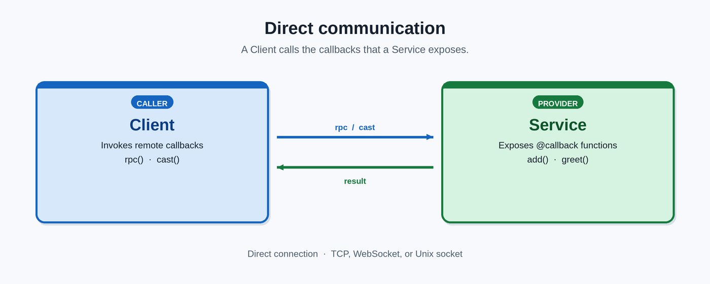
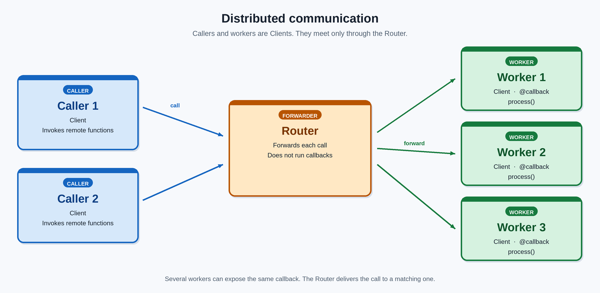

# Architecture

Daffi supports two primary communication topologies: direct communication between a Client and a Service, and distributed communication through a Router.

## Core components

| Component | Description |
|---|---|
| `Service` | Listens for incoming connections and exposes remotely callable `@callback` functions. |
| `Router` | Forwards messages between connected nodes. It does not execute callbacks itself. |
| `Client` | Connects to a Service or Router. It can issue remote calls, expose callbacks, or do both. |

Both `Service` and `Client` can expose `@callback` functions. The topology determines how those callbacks are reached.

| Topology | Who exposes `@callback` | Who calls |
|---|---|---|
| **Client → Service** | The `Service` | Clients (typically pure callers) |
| **Client → Router → Worker** | Any `Client` (workers, callers, or both) | Any other connected `Client` |

In the Router topology a "worker" is simply a `Client` that has registered `@callback` functions — there is no separate worker class.

---

## Direct communication

In a direct connection, a Client communicates with a Service.

- The Service exposes callbacks.
- The Client invokes those callbacks remotely.
- Multiple Clients can connect to the same Service simultaneously.

**When to use:** Simple request/response scenarios where one process owns the logic.

See [Direct topology (Service)](usage/service.md).

---

## Distributed communication

A Router enables multiple Clients to participate in a shared communication network.

- Workers expose callbacks through their Client connections.
- Callers invoke remote functions through the Router.
- The Router forwards calls to matching workers.
- Multiple workers can provide the same callback.
- `rpc()` load-balances across matching workers (round-robin).
- `cast()` fans out to all matching workers.

A single Client can both expose callbacks and call remote ones over the same Router connection.

**When to use:** Worker pools, fan-out broadcasting, bidirectional peer communication, scalable deployments.

See [Router and workers](usage/router.md).
