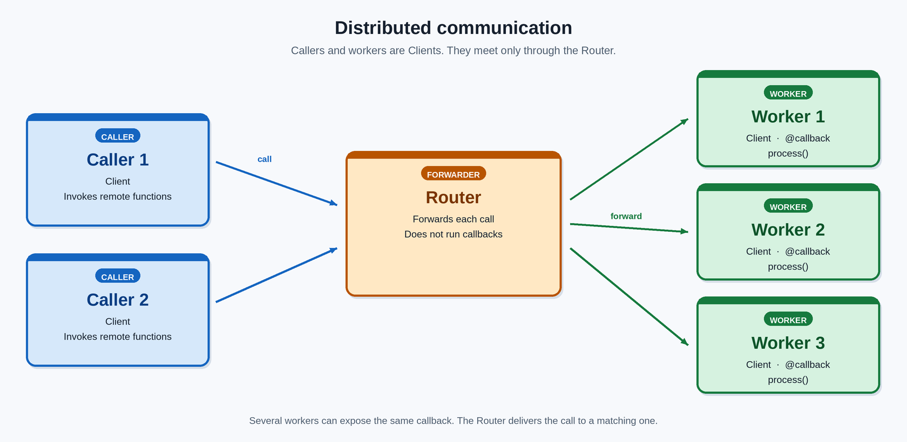

# Router and workers



The Router topology decouples callers from workers. The **Router** is a pure message forwarder; **Workers** register their callbacks with it; **Callers** invoke those callbacks through it.

---

## 1. Start the Router

The Router has no callbacks of its own — it only forwards messages.

```python
from daffi import Router, TCPTransport

if __name__ == "__main__":
    router = Router(transport=TCPTransport("127.0.0.1", 6001))
    router.start()
    print("Router running on 127.0.0.1:6001 — press Ctrl+C to stop.")
    router.join()
```

### `Router` parameters

| Parameter | Type | Description |
|---|---|---|
| `transport` | transport or sequence | One `TCPTransport` or `UnixTransport`, or several. Every listener shares this router's membership. `start()` brings all of them up at once or none of them. TLS is set on each `TCPTransport`. |
| `runtime` | `Runtime` | `THREADS` or `EVENTED` for this process. Omit for `threads`. One process, one choice. |
| `auth_token` | `str` | Shared secret. Every peer must send the same token in its handshake. A peer without it is disconnected before it can call anything. Omit to accept any peer. |

Requests are only accepted from peers that have completed the handshake, under the name they registered. A request that names another peer as its sender is answered with `UnknownSender`. A reply is only accepted from the peer the request was routed to.

To listen on TCP and Unix together (remote peers + co-located processes), pass a list of transports — see [Transports](transports.md).

---

## 2. Connect Workers

Workers are **Clients** that expose `@callback` functions. Start as many instances as you need — the Router load-balances across them.

```python
from daffi import Client, callback, TCPTransport

@callback
def multiply(a: int, b: int) -> int:
    return a * b

if __name__ == "__main__":
    worker = Client(app_name="calc-worker", transport=TCPTransport("127.0.0.1", 6001))
    worker.connect()
    print("Worker connected — press Ctrl+C to stop.")
    worker.join()
```

!!! tip
    Run two instances of this script in separate terminals. `rpc()` will round-robin between them; `cast()` will call both.

Each worker `Client` accepts the same `workers` parameter as `Service` for in-process callback concurrency. For CPU-bound work, prefer multiple worker processes behind the Router rather than raising `workers` on one process — see [Callbacks and concurrency](callbacks.md).

```python
import os
from daffi import Client, TCPTransport

# Start N instances — one per core. The Router load-balances across them.
worker = Client(
    app_name=f"cpu-worker-{os.getpid()}",
    workers=1,
    transport=TCPTransport("127.0.0.1", 6001),
)
worker.connect()
worker.join()
```

---

## 3. Connect a Caller

Callers are also **Clients** — they just don't expose any `@callback` functions.

```python
from daffi import Client, TCPTransport

if __name__ == "__main__":
    caller = Client(app_name="calc-caller", transport=TCPTransport("127.0.0.1", 6001))
    conn = caller.connect()

    # Round-robin — any available worker handles this call.
    result = conn.rpc(timeout=5).multiply(6, 7)
    print(f"multiply(6, 7) = {result}")  # → 42

    # Pin to a specific worker by name.
    result = conn.rpc(timeout=5, receiver="calc-worker").multiply(3, 3)

    caller.stop()
```

---

## Bidirectional communication

Because every Client can both expose callbacks and call remote ones, bidirectional communication is natural: two nodes connect to the same Router and call each other.

```python
# node_a.py
from daffi import Client, callback, TCPTransport

@callback
def hello_from_a(msg: str) -> str:
    return f"A received: {msg}"

node_a = Client(app_name="node-A", transport=TCPTransport("127.0.0.1", 6003))
conn = node_a.connect()

reply = conn.rpc(timeout=5, receiver="node-B").hello_from_b("hi from A")
print(reply)
```

```python
# node_b.py
from daffi import Client, callback, TCPTransport

@callback
def hello_from_b(msg: str) -> str:
    return f"B received: {msg}"

node_b = Client(app_name="node-B", transport=TCPTransport("127.0.0.1", 6003))
conn = node_b.connect()
node_b.join()
```

---

## cast() via Router

`cast()` fans out to every worker that exposes the requested function and collects all results.

```python
conn = caller.connect()

results = conn.cast(timeout=5).process("task-A")
# → {"worker-1": result, "worker-2": result, ...}

results = conn.cast(timeout=5, receiver=["worker-1"]).process("task-B")

conn.cast_nowait().process("task-C")
```

See [Communication patterns](call-styles.md) for the full comparison of call styles.

---

## Waiting for members

In a multi-worker environment the caller often starts before all workers are online. Use `conn.wait_for_members()` to block until the required peers appear:

```python
from daffi import Client, TCPTransport

caller = Client(app_name="calc-caller", transport=TCPTransport("127.0.0.1", 6001))
conn = caller.connect()

# Block until both workers have registered — start order doesn't matter.
conn.wait_for_members("worker-1", "worker-2")

results = conn.cast(timeout=10).process("task")
caller.stop()
```

An optional `timeout` raises `TimeoutError` if the deadline is exceeded:

```python
conn.wait_for_members("slow-worker", timeout=30)
```

| Parameter | Type | Default | Description |
|---|---|---|---|
| `*members` | `str` | — | One or more peer names to wait for. |
| `timeout` | `float \| None` | `None` | Max seconds to wait. `None` waits forever. |

---

## Examples

| Example | Location |
|---|---|
| Basic rpc via router | `examples/router/01_rpc/` |
| cast / cast_nowait via router | `examples/router/02_cast/` |
| Bidirectional communication | `examples/router/03_bidirectional/` |
| Serialization formats | `examples/router/04_serde_pickle/` … `07_serde_msgpack/` |
| Events via router | `examples/router/08_events/` |
| Waiting for members | `examples/router/09_wait_for_members/` |
| TCP and Unix on one Router | `examples/router/10_multitransport/` |
