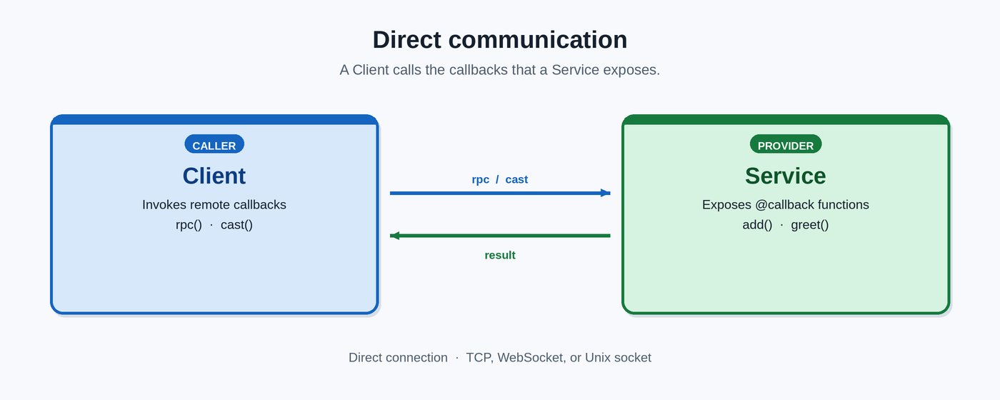

# Direct topology (Service)



The simplest Daffi topology: a **Service** hosts `@callback` functions; **Clients** call them.

!!! note "Callbacks in the Service vs Router topology"
    In this topology Clients are typically pure callers — they connect to the Service and issue remote calls.

    If you need Clients that also expose `@callback` functions (workers) or peers that call each other, use the [Router topology](router.md) instead.

---

## Service

```python
from daffi import Service, callback, TCPTransport

@callback
def add(a: int, b: int) -> int:
    return a + b

@callback
def greet(name: str) -> str:
    return f"Hello, {name}!"

if __name__ == "__main__":
    svc = Service(
        app_name="calc-service",
        transport=TCPTransport("127.0.0.1", 5001),
    )
    svc.start()
    print("Service running — press Ctrl+C to stop.")
    svc.join()
```

### `Service` parameters

| Parameter | Type | Description |
|---|---|---|
| `app_name` | `str` | Unique name for this node. Auto-generated if omitted. |
| `transport` | transport or sequence | One `TCPTransport` or `UnixTransport`, or several. Every listener shares this node's membership. `start()` brings all of them up at once or none of them. TLS is set on each `TCPTransport`. |
| `workers` | `int` | Concurrency level for callback execution. Default: `1` (sequential). See [Callbacks and concurrency](callbacks.md). |
| `runtime` | `Runtime` | `THREADS` or `EVENTED` for this process. Omit for `threads`. See [Native runtime](runtime.md). |
| `auth_token` | `str` | Shared secret every client must send in its handshake. Omit to accept any client. |
| `serdes` | `SerdeFormat` | Receiver-side deserialization policy. Default: `ALL`. Pass `SAFE` to refuse PICKLE. See [Serialization](serialization.md). |
| `callbacks` | list | The `@callback` functions (or their names) this node offers. Default: every registered callback. |

---

## Client

```python
from daffi import Client, TCPTransport

if __name__ == "__main__":
    client = Client(app_name="calc-client", transport=TCPTransport("127.0.0.1", 5001))
    conn = client.connect()

    result = conn.rpc(timeout=5).add(3, 4)
    print(f"add(3, 4) = {result}")  # → 7

    conn.rpc_nowait().greet("world")

    client.stop()
```

### `Client` parameters

| Parameter | Type | Description |
|---|---|---|
| `app_name` | `str` | Unique name for this node. |
| `transport` | `TCPTransport` or `UnixTransport` | The one address this client connects to. |
| `runtime` | `Runtime` | `THREADS` or `EVENTED` for this process. Omit for `threads`. |
| `auth_token` | `str` | The token of a server started with `auth_token=`. |
| `workers` | `int` | Concurrency for incoming callbacks when this Client acts as a worker. |
| `callbacks` | list | For a client acting as a worker: the callbacks it offers. Default: every registered callback. |
| `serdes` | `SerdeFormat` | Receiver-side deserialization policy. |

---

## Calling the Service

```python
conn = client.connect()

# Blocking call
result = conn.rpc(timeout=5).add(3, 4)

# Fire-and-forget
conn.rpc_nowait().greet("world")

# Broadcast — one entry when only one Service is running
results = conn.cast(timeout=5).add(1, 2)

# Stream chunks (see Communication patterns)
conn.stream(serde=SerdeFormat.OPAQUE).process_stream(chunk_source("large.bin"))
```

Full option tables for every call style: [Communication patterns](call-styles.md).

---

## Class callbacks

Apply `@callback` to an entire class to export its public methods. Methods starting with `_` and methods marked `@local` are not exported.

```python
from daffi import Service, callback, TCPTransport
from daffi.registry import local


@callback
class TextProcessor:
    def upper(self, text: str) -> str:
        return text.upper()

    def reverse(self, text: str) -> str:
        return text[::-1]

    @local
    def reset(self):
        pass


if __name__ == "__main__":
    svc = Service(app_name="text-service", transport=TCPTransport("127.0.0.1", 5003))
    svc.start()
    svc.join()
```

See [Callbacks and concurrency](callbacks.md) for rules and `workers` guidance.

---

## Examples

| Example | Location |
|---|---|
| Basic rpc | `examples/service/01_rpc/` |
| Class-based callbacks | `examples/service/03_class_callbacks/` |
| Serialization formats | `examples/service/04_serde_pickle/` … `07_serde_msgpack/` |
| Unix socket | `examples/service/08_unix_socket/` |
| Events | `examples/service/09_events/` |
| Generator streaming | `examples/service/10_stream/` |
| TCP and Unix on one Service | `examples/service/11_multitransport/` |
